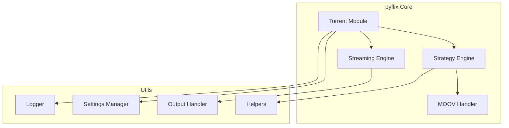

# Architecture Documentation

This directory contains high-level system architecture documentation, including diagrams, component relationships, and design patterns used throughout pyflix.

## Purpose

Architecture documentation provides:
1. **System Overview**: Visual understanding of how components interact
2. **Onboarding**: Help new developers and AI agents understand the system
3. **Design Reference**: Document patterns and conventions
4. **Change Impact Analysis**: Understand what a change might affect

## Current Architecture

### System Overview

### Component Descriptions

| Component | Location | Purpose |
|-----------|----------|---------|
| Torrent Module | `torrent/` | Core torrent handling and coordination |
| Strategy Engine | `torrent/strategy.py` | Download prioritization strategy |
| MOOV Handler | `torrent/moov.py` | Video atom detection for streaming |
| Settings Manager | `utils/settings.py` | Configuration management |
| Logger | `utils/logger.py` | Centralized logging |
| Helpers | `utils/helpers.py` | Utility functions |
| Output Handler | `utils/output.py` | Output formatting |

## Documentation Standards

### Diagrams
All diagrams should be created using [Mermaid.js](https://mermaid.js.org/) for:
- Version control compatibility (text-based)
- GitHub rendering support
- Easy updates

### Diagram Types

1. **Flowcharts** (`graph`): For process flows and decision trees
2. **Sequence Diagrams** (`sequenceDiagram`): For interactions between components
3. **Class Diagrams** (`classDiagram`): For object relationships
4. **State Diagrams** (`stateDiagram-v2`): For state machines

## For AI Agents

1. **Reference architecture before making changes** to understand impact
2. **Update diagrams** when adding new components or changing relationships
3. **Create new diagrams** for complex new features
4. Use Mermaid.js syntax for all visual documentation

## Index

| Document | Description | Last Updated |
|----------|-------------|--------------|
| README.md | This overview | Current |
