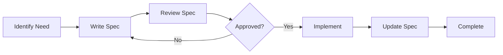

# Technical Specifications

This directory contains technical specifications for features, APIs, and system components. **Specifications must be written BEFORE implementation begins.**

## Purpose

Technical specifications serve as:
1. **Design Documents**: Clarify requirements before coding
2. **Communication Tools**: Share design intent with team members and AI agents
3. **Review Artifacts**: Enable design review before implementation effort
4. **Reference Documentation**: Provide context for future maintenance

## Specification Workflow



### 1. Write Specification
Before writing any code, create a specification document that includes:
- Problem statement
- Proposed solution
- API contracts (if applicable)
- Data models
- Edge cases and error handling
- Testing strategy

### 2. Review & Approve
- Specifications should be reviewed before implementation
- Use PR comments or discussion threads for feedback
- Mark specification as "Approved" when ready

### 3. Implement
- Reference the specification during implementation
- The spec is the source of truth for behavior

### 4. Update
- Keep specifications in sync with implementation
- Document any deviations with rationale

## File Naming Convention

```
[category]-[feature-name].md
```

Examples:
- `api-torrent-streaming.md`
- `feature-moov-detection.md`
- `integration-external-services.md`

## For AI Agents

1. **Never implement features without a specification**
2. If asked to implement something without a spec, create the spec first
3. Reference spec file paths in code comments for traceability
4. Update specs when implementation reveals necessary changes

## Index

| Spec | Category | Status | Last Updated |
|------|----------|--------|--------------|
| (No specifications yet) | - | - | - |
