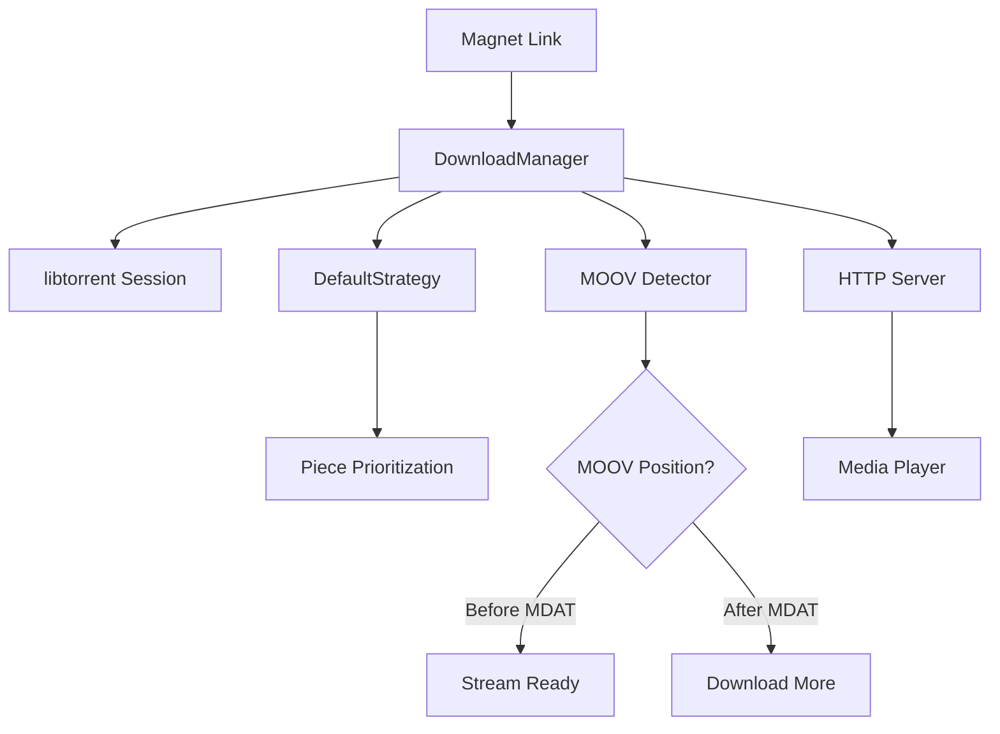

# Feature: Core Torrent Streaming

## Status
Implemented (Documentation retroactive)

## Overview

pyflix provides torrent streaming capabilities by combining sequential downloading with an HTTP server for immediate video playback.

## Background

Traditional torrent downloads are optimized for speed, downloading pieces in any order. This makes video playback impossible until the download completes. pyflix solves this by:

1. Prioritizing initial video pieces for quick playback start
2. Detecting MOOV atom position for MP4 streamability
3. Serving downloaded content via HTTP as it becomes available

## Requirements

### Functional Requirements

- **REQ-1**: Accept magnet links as input for torrent downloads
- **REQ-2**: Download video pieces sequentially from the start
- **REQ-3**: Detect if MP4 MOOV atom is positioned for streaming
- **REQ-4**: Serve downloaded content via HTTP server
- **REQ-5**: Support VLC player integration
- **REQ-6**: Allow configurable download/upload limits
- **REQ-7**: Provide status information (progress, peers, rates)

### Non-Functional Requirements

- **REQ-8**: Begin serving within seconds of metadata download
- **REQ-9**: Support HTTP range requests for seeking
- **REQ-10**: Configurable via YAML settings file

## Design

### Components



### Key Classes

#### DownloadManager
```python
class DownloadManager:
    def __init__(self, magnet, port=None, serve=False, player=None, save_path=None):
        """Initialize download manager with magnet link and options."""
        
    def start(self):
        """Begin downloading and optionally streaming."""
        
    def stream(self):
        """Start HTTP server for video streaming."""
        
    @property
    def status(self):
        """Return current download status."""
```

#### DefaultStrategy
```python
class DefaultStrategy:
    def __init__(self, manager):
        """Initialize strategy with DownloadManager reference."""
        
    def initial(self):
        """Set up initial piece priorities."""
        
    def master(self):
        """Main strategy loop - adjust priorities based on download state."""
        
    def move_strategy(self, first_block):
        """Shift priority window to new position."""
```

#### have_moov
```python
def have_moov(video_file: str) -> bool | tuple[bool, str]:
    """Check if video file has MOOV atom positioned for streaming.
    
    Returns:
        True if MOOV before MDAT (streamable)
        (True, "after_mdat") if MOOV after MDAT (needs processing)
        False if MOOV detection fails
    """
```

### Configuration

```yaml
# ~/.pyflix/settings.yaml
save_path: "/downloads/torrents"

strategy:
  piece_st: 4           # Initial pieces to prioritize
  last_piece_st: 4      # Final pieces to prioritize
  chunks_strat: 10      # Chunk size for strategy moves
  always_sequential: false

limits:
  upload: 0             # KB/s, 0 = unlimited
  download: 0

players:
  default: "vlc"
```

## Testing Strategy

### Unit Tests
- `test_moov.py`: MOOV atom detection with various MP4 structures
- `test_output.py`: VLC command generation
- `test_settings.py`: Configuration loading and defaults
- `test_helpers.py`: Utility functions (ports, interfaces, paths)

### Integration Tests
- Full download workflow with mock torrent
- HTTP server range request handling
- Strategy piece prioritization

### Manual Testing
1. Start with known magnet link
2. Verify HTTP server starts
3. Open in VLC at localhost:PORT
4. Verify playback begins before download completes

## Open Questions

- Q1: Should we support other players besides VLC?
- Q2: How to handle torrents with multiple video files?
- Q3: Should MOOV relocation be done in-place?

## References

- [libtorrent Documentation](https://libtorrent.org/reference.html)
- [qtfaststart](https://github.com/danielgtaylor/qtfaststart) - MOOV atom handling
- [MP4 File Structure](https://developer.apple.com/library/archive/documentation/QuickTime/QTFF/QTFFChap2/qtff2.html)
